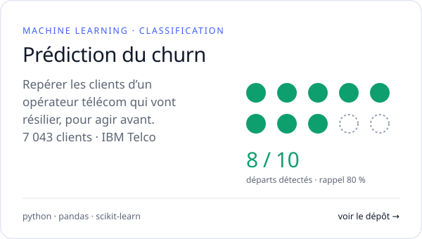
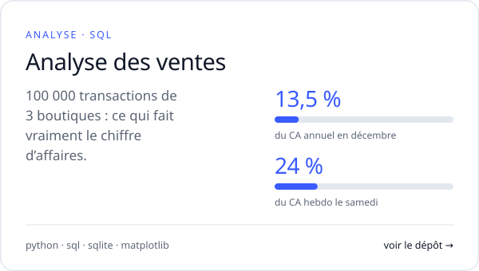
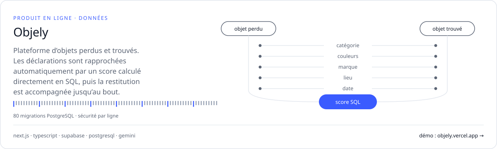
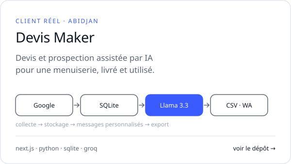
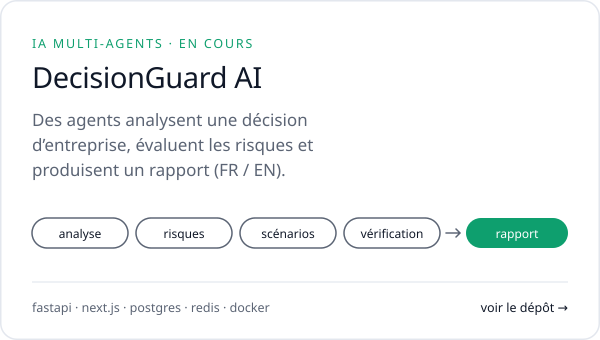
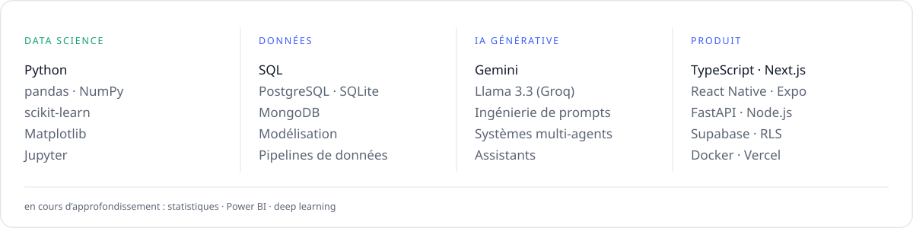

<picture><source media="(prefers-color-scheme: dark)" srcset="assets/hero-dark.svg"></picture>

<h3>Projets data</h3>

<a href="https://github.com/maureljean55/prediction-churn-clients"><picture><source media="(prefers-color-scheme: dark)" srcset="assets/churn-dark.svg"></picture></a>
<a href="https://github.com/maureljean55/analyse-ventes-magasin"><picture><source media="(prefers-color-scheme: dark)" srcset="assets/ventes-dark.svg"></picture></a>

<h3>Produits en ligne</h3>

<a href="https://objely.vercel.app"><picture><source media="(prefers-color-scheme: dark)" srcset="assets/objely-dark.svg"></picture></a>

Écosystème Objely : <a href="https://github.com/maureljean55/objely">plateforme</a> · <a href="https://github.com/maureljean55/objely-admin">portail d'administration</a> (<a href="https://objely-admi.vercel.app">démo</a>) · <a href="https://github.com/maureljean55/objely-ecole">borne pour écoles</a> (<a href="https://objely-ecole.vercel.app">démo</a>) · <a href="https://github.com/maureljean55/objely-admin-ecole">gestion vie scolaire</a>

<a href="https://github.com/maureljean55/devis-maker"><picture><source media="(prefers-color-scheme: dark)" srcset="assets/devis-dark.svg"></picture></a>
<a href="https://github.com/maureljean55/DecisionGuard-AI"><picture><source media="(prefers-color-scheme: dark)" srcset="assets/decisionguard-dark.svg"></picture></a>

<h3>Compétences</h3>

<picture><source media="(prefers-color-scheme: dark)" srcset="assets/stack-dark.svg"></picture>

Je recherche un <b>stage ou une alternance en Data Science</b>, en Île-de-France ou partout en France. Merci de votre visite.

